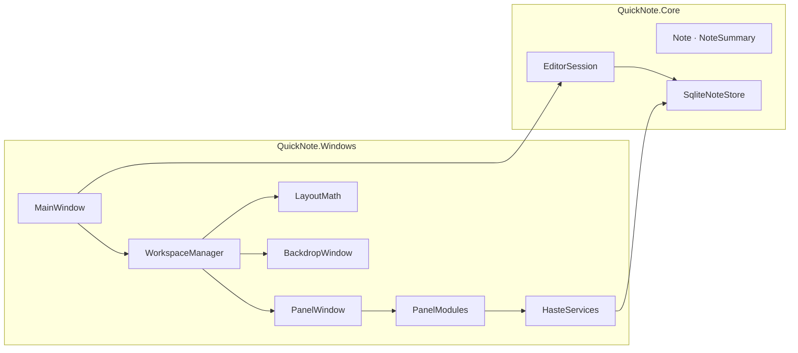

<div align="center">

# haste

**Ouvrir. Écrire. Retrouver. Fermer.**

Une application de notes pour Windows, rapide et minimaliste,<br>
entourée d’un espace de travail multi-fenêtres entièrement personnalisable.

[](https://github.com/LoFieee/Haste-Releases/releases/latest)
[](https://github.com/LoFieee/Haste-Releases/releases)


[Télécharger](https://github.com/LoFieee/Haste-Releases/releases/latest) ·
[Fonctionnalités](#fonctionnalités) ·
[Espace de travail](#espace-de-travail) ·
[Développement](#développement) ·
[Publier une version](#publier-une-version)

</div>

---

## Sommaire

- [Présentation](#présentation)
- [Fonctionnalités](#fonctionnalités)
- [Espace de travail](#espace-de-travail)
  - [Dispositions fournies](#dispositions-fournies)
  - [Modules](#modules)
  - [Organiser les fenêtres](#organiser-les-fenêtres)
- [Raccourcis clavier](#raccourcis-clavier)
- [Installation](#installation)
- [Développement](#développement)
- [Architecture](#architecture)
- [Créer un module](#créer-un-module)
- [Publier une version](#publier-une-version)
- [Données et confidentialité](#données-et-confidentialité)
- [Feuille de route](#feuille-de-route)
- [Composants tiers](#composants-tiers)
- [Licence](#licence)

---

## Présentation

haste est conçu autour d’une idée simple : capturer une pensée sans friction. Un raccourci global l’affiche par-dessus n’importe quelle application ; on écrit, la note s’enregistre seule, et le même raccourci le fait disparaître.

Autour de la fenêtre principale, l’**espace de travail** ajoute des fenêtres de modules (explorateur de notes, liste de tâches, terminal, OSINT Framework, Discord, Spotify…), toutes dans la même esthétique, disposées sur une grille et rappelées d’un seul raccourci.

> [!NOTE]
> haste est **local-first** : toutes les données restent sur la machine, dans une base SQLite. Aucun compte n’est nécessaire.

---

## Fonctionnalités

<table>
<tr>
<td width="50%" valign="top">

### Notes

- Création instantanée et **enregistrement automatique**
- **Recherche** dans le titre et le contenu, avec extrait et mise en évidence
- **Sélection multiple** et suppression groupée
- **Rappels** par note, avec notification Windows
- Éditeur compact qui s’agrandit avec le texte
- Navigation entièrement au clavier

</td>
<td width="50%" valign="top">

### Espace de travail

- Fenêtres de modules autour de haste
- **Sept dispositions** prêtes à l’emploi
- **Moules** d’aimantation pendant le déplacement
- Boutons **« + »** dans les zones libres
- **Fond flouté** derrière l’application
- **Roue crantée** de réglages sur chaque fenêtre

</td>
</tr>
<tr>
<td valign="top">

### Intégrations

- Google (Gmail, Agenda, Drive)
- Discord, Slack, Microsoft Teams
- Claude ou ChatGPT
- Spotify, Deezer, YouTube Music, YouTube
- OSINT Framework, Overpass Turbo
- Navigateur et terminal intégrés

</td>
<td valign="top">

### Confort

- **Mise à jour automatique** depuis GitHub
- Raccourcis personnalisables
- Animations et sons désactivables
- Démarrage avec Windows
- Icône dans la zone de notification
- Prise en charge du multi-écran et du DPI par écran

</td>
</tr>
</table>

---

## Espace de travail

L’espace de travail s’active dans **Paramètres → Espace de travail**. Désactivé, haste redevient un simple popup.

```text
 Disposition « Main » (par défaut)
┌────────────────┬────────────────┬────────────────┐
│     notes      │     haste      │       +        │
├────────────────┼────────────────┼────────────────┤
│       +        │       +        │       +        │
└────────────────┴────────────────┴────────────────┘
```

### Dispositions fournies

| Disposition | Contenu |
| --- | --- |
| **Main** | haste et l’explorateur de notes ; les autres cases sont libres |
| **Haste** | notes, haste, rappels, brouillon, OSINT Framework |
| **OSINT** | haste, brouillon, OSINT Framework, Overpass Turbo, une case libre |
| **SOCIAL** | Discord, haste, musique |
| **FOCUS** | explorateur de notes, haste, liste à faire, une case libre |
| **DOOMSCROLL** | YouTube Shorts, TikTok, YouTube, Subway Surfers, haste |
| **WEBFRONT VIBECODE** | assistant IA, haste, GitHub, YouTube, terminal |

Les dispositions se créent, se dupliquent, se renomment et se suppriment depuis **disposition** sur l’accueil. Toutes sont dessinées sur une grille de **12 × 12**, alignée sur les cases **3 × 2** des moules et des boutons « + ».

### Modules

| Module | Description |
| --- | --- |
| **haste** | La fenêtre principale, déplaçable dans n’importe quelle case |
| **notes** | Explorateur de notes, filtre instantané |
| **brouillon** | Bloc persistant : copier, extraire les liens, transformer en note |
| **à faire** | Liste de tâches cochable |
| **rappels** | Heure, date et rappels à venir |
| **terminal** | Session PowerShell ou cmd persistante, avec historique |
| **osint framework** | osintframework.com en mode sombre |
| **assistant ia** | Claude ou ChatGPT |
| **musique** | Spotify, Deezer, YouTube Music ou YouTube |
| **google** | Gmail, Agenda, Drive, Compte |
| **discord** · **slack** · **teams** | Versions web, connectées à votre compte |
| **navigateur** | N’importe quelle page ; la fenêtre prend le nom du site |
| **fenêtre libre** | Emplacement réservé |

> [!TIP]
> Les connexions aux services web sont conservées dans un profil unique, partagé par toutes les fenêtres et gardé entre deux lancements : une connexion faite une fois vaut partout.

### Organiser les fenêtres

| Action | Comportement |
| --- | --- |
| Déplacer par la barre de titre | Une grille de 3 × 2 **moules** s’affiche. Lâchée dans un moule libre, la fenêtre en prend la forme ; lâchée sur une autre fenêtre, les deux s’échangent |
| Tirer un bord ou un coin | Redimensionne ; les voisines **reculent** pour faire de la place, jusqu’à leur taille minimale |
| Cliquer sur **+** | Crée une fenêtre qui remplit la case libre et ouvre le choix du module |
| Cliquer sur la **roue crantée** | Réglages du module, choix du module, masquer la fenêtre |
| Cliquer dans le vide | Masque haste |

> [!IMPORTANT]
> La fenêtre utilisée reste toujours au premier plan. Quand vous passez à une autre application, haste se met en retrait pour ne pas la recouvrir, puis revient dès que vous cliquez sur l’une de ses fenêtres.

---

## Raccourcis clavier

| Raccourci | Action |
| --- | --- |
| <kbd>Ctrl</kbd> + <kbd>Alt</kbd> + <kbd>I</kbd> | Afficher ou masquer haste (configurable) |
| <kbd>W</kbd> | Écrire une nouvelle note depuis l’accueil (configurable) |
| <kbd>R</kbd> | Consulter les notes depuis l’accueil (configurable) |
| <kbd>Échap</kbd> | Revenir en arrière, puis masquer haste |
| <kbd>Entrée</kbd> | Dans un filtre : ouvrir le premier résultat |
| <kbd>↑</kbd> <kbd>↓</kbd> | Dans le terminal : parcourir l’historique |

Le raccourci global fonctionne comme un interrupteur : il ouvre haste s’il est masqué et le masque s’il est visible, même sans focus.

---

## Installation

1. Télécharger `Haste-Setup.exe` depuis la [dernière version](https://github.com/LoFieee/Haste-Releases/releases/latest).
2. Lancer l’installeur.
3. Appuyer sur <kbd>Ctrl</kbd> + <kbd>Alt</kbd> + <kbd>I</kbd>.

**Configuration requise :** Windows 10 version 1809 ou ultérieure, ou Windows 11, x64. Le runtime Microsoft Edge WebView2, présent par défaut sur ces systèmes, est utilisé par les modules web.

Les mises à jour sont ensuite détectées et installées automatiquement.

---

## Développement

### Prérequis

- [.NET 10 SDK](https://dotnet.microsoft.com/download)
- Windows 10 (1809+) ou Windows 11

### Compiler et lancer

```bat
git clone <URL_DU_DÉPÔT>
cd haste\src\QuickNote.Windows
dotnet restore
dotnet build
dotnet run
```

> [!WARNING]
> `TreatWarningsAsErrors` est actif : le moindre avertissement, nullabilité comprise, bloque la compilation. Un garde-fou interrompt aussi le build si une copie en double du projet est détectée dans un sous-dossier. Pour mettre à jour les sources, supprimez toujours l’ancien dossier avant d’extraire la nouvelle version.

### Conventions

- **Cible :** `net10.0-windows10.0.17763.0`
- **Esthétique :** fond `#2A2A2A`, police Helvetica, coins arrondis, fond topographique, accent `#FF3B30` réservé à la sélection
- **Interface :** en français, apostrophe typographique (’) et guillemets « »
- **Performances :** les panneaux sont des fenêtres opaques ; aucune animation ni recalcul à chaque image sur les panneaux
- **Données :** toute évolution du format passe par une migration qui préserve l’existant

---

## Architecture



| Projet | Rôle |
| --- | --- |
| `QuickNote.Core` | Modèle de notes, persistance SQLite, sessions d’édition. Indépendant de WPF |
| `QuickNote.Windows` | Interface WPF, raccourcis globaux, zone de notification, mises à jour, espace de travail |

<details>
<summary><b>Arborescence de l’espace de travail</b></summary>

```text
src/QuickNote.Windows/Workspace/
├── WorkspaceSettings.cs    Modèle, dispositions fournies, migrations, workspace.json
├── WorkspaceManager.cs     Cycle de vie des fenêtres, placement, priorité, fond
├── LayoutMath.cs           Géométrie pure : cases libres, moules, recul des voisines
├── PanelWindow.cs          Coque haste commune à tous les panneaux
├── PanelModules.cs         Contrats IPanelModule / IPanelOptions et registre
├── HasteServices.cs        Notes, rappels et actions offerts aux modules
├── BackdropWindow.cs       Fond flouté, boutons « + », moules
├── LayoutEditorView.cs     Éditeur de disposition
├── LayoutCanvas.cs         Aperçu interactif de l’écran
├── WindowResizer.cs        Poignées de redimensionnement
├── WorkspaceNative.cs      Win32 : pixels physiques, DPI par écran, ordre d’affichage
├── HasteUi.cs              Briques visuelles et icônes
└── Modules/
    ├── WebPanelView.cs     Sites et services web (WebView2)
    ├── RecentNotesView.cs  Explorateur de notes
    ├── ScratchpadView.cs   Brouillon
    ├── TodoView.cs         Liste à faire
    ├── RemindersView.cs    Rappels et horloge
    ├── TerminalView.cs     Terminal
    └── EmptyPanelView.cs   Fenêtre libre
```

</details>

---

## Créer un module

Un module est une classe qui implémente `IPanelModule`, ajoutée à la liste de `Workspace/PanelModules.cs`. Il apparaît alors automatiquement dans les réglages de chaque fenêtre et dans l’éditeur de disposition.

```csharp
internal sealed class ClockModule : IPanelModule
{
    public string Id => "clock";            // identifiant stable, enregistré dans workspace.json
    public string Title => "horloge";
    public string Description => "L’heure, en grand.";
    public string Icon => HasteIcons.Clock;
    public Thickness ContentPadding => new(22, 6, 22, 22);

    public FrameworkElement CreateView(PanelContext context) =>
        HasteUi.Text(DateTime.Now.ToString("HH:mm"), 48, bold: true);
}
```

| API | Usage |
| --- | --- |
| `context.Get` / `Set` / `GetBool` / `SetBool` | Réglages propres à la fenêtre, enregistrés automatiquement |
| `context.Services` | Notes, rappels, événements `NotesChanged` / `RemindersChanged`, actions `OpenNoteAsync`, `CreateNoteAsync`, `NewNoteAsync` |
| `IPanelOptions` | Réglages affichés sous la roue crantée |
| `IDisposable` | Libération des ressources quand la fenêtre change de module |
| `HasteUi` | Textes, boutons, cartes, interrupteurs et dialogues au style haste |

Un service web se déclare en une ligne grâce à `SiteModule`, avec une liste de services entre lesquels l’utilisateur peut basculer.

---

## Publier une version

haste vérifie [LoFieee/Haste-Releases](https://github.com/LoFieee/Haste-Releases) au démarrage puis toutes les six heures. L’installeur est téléchargé en arrière-plan, et l’utilisateur peut l’installer d’un clic depuis la notification ou depuis **Paramètres → Mises à jour**. Lorsque haste a démarré avec Windows, la mise à jour s’installe seule.

1. Incrémenter `<Version>` dans `src/QuickNote.Windows/QuickNote.Windows.csproj`.
2. Publier :

   ```bat
   taskkill /IM haste.exe /F
   dotnet publish -c Release -r win-x64 --self-contained true -o ..\..\dist\Haste
   ```

3. Compiler l’installeur avec **Inno Setup** : il doit produire `Haste-Setup.exe`.
4. Créer une release sur **Haste-Releases**, avec le tag `vX.Y.Z` et `Haste-Setup.exe` en pièce jointe.

> [!CAUTION]
> La mise à jour automatique lance l’installeur avec `/VERYSILENT /SUPPRESSMSGBOXES /NORESTART /SP-`, des options propres à **Inno Setup**. Le script NSIS présent dans `packaging/` reste utilisable pour une distribution manuelle, mais pas pour les mises à jour automatiques.

<details>
<summary><b>Liste de vérification avant publication</b></summary>

- [ ] `dotnet build` sans avertissement
- [ ] Tour complet : notes, recherche, rappels, espace de travail, modules web
- [ ] Version incrémentée et texte « Quoi de neuf » à jour
- [ ] `dotnet publish` puis vérification de `dist\Haste\haste.exe`
- [ ] Installeur compilé et testé sur une machine propre
- [ ] Mise à jour testée depuis la version précédente
- [ ] Release publiée sur Haste-Releases

</details>

---

## Données et confidentialité

Toutes les données sont stockées localement, dans `%LOCALAPPDATA%\QuickNote` :

| Fichier ou dossier | Contenu |
| --- | --- |
| `notes.db` | Notes (SQLite) |
| `preferences.json` | Paramètres |
| `workspace.json` | Dispositions et réglages des fenêtres |
| `reminders.json` | Rappels |
| `scratch/`, `todo/` | Brouillons et listes de tâches |
| `WebView2/` | Profil web : cookies et sessions des services connectés |

Ces fichiers ne doivent jamais être versionnés ; ils sont exclus par le `.gitignore`. haste n’envoie aucune donnée de notes en ligne. Les seules connexions réseau concernent la vérification des mises à jour et les modules web ouverts par l’utilisateur.

---

## Feuille de route

| Priorité | Fonctionnalité |
| --- | --- |
| Lot 1 | Explorateur en arborescence avec dossiers, palette de commandes <kbd>Ctrl</kbd>+<kbd>K</kbd>, aide <kbd>Ctrl</kbd>+<kbd>?</kbd>, raccourcis par disposition, tags et épinglage, corbeille |
| Lot 2 | Markdown léger, liens entre notes, historique des versions, modèles, capture rapide, recherche avancée |
| Lot 3 | Sauvegarde externe, export et import, verrouillage, reprise de session, rappels intelligents |
| Lot 4 | Pièces jointes, glisser-déposer entre fenêtres, notes flottantes, presse-papiers étendu, Pomodoro, thèmes d’accent |
| Plus tard | Synchronisation chiffrée entre PC, signature de l’exécutable et de l’installeur |

---

## Composants tiers

| Composant | Usage | Licence |
| --- | --- | --- |
| .NET 10, WPF, Windows Forms | Runtime et interface | MIT |
| [Microsoft.Data.Sqlite](https://github.com/dotnet/efcore) | Accès SQLite | MIT |
| [SQLitePCLRaw](https://github.com/ericsink/SQLitePCL.raw) | Liaison SQLite native | Apache-2.0 |
| [SQLite](https://sqlite.org/copyright.html) | Base embarquée | Domaine public |
| [Microsoft.Web.WebView2](https://www.nuget.org/packages/Microsoft.Web.WebView2) | Modules web | Licence Microsoft du paquet |

Le détail figure dans [`THIRD-PARTY-NOTICES.md`](THIRD-PARTY-NOTICES.md) et dans le dossier [`licenses/`](licenses/).

---

## Licence

© 2026 L’équipe haste. Tous droits réservés.

<div align="center">
<br>
<sub><b>haste</b> · pas de tableau de bord lourd, pas de friction · juste l’idée, au moment où elle arrive.</sub>
</div>
